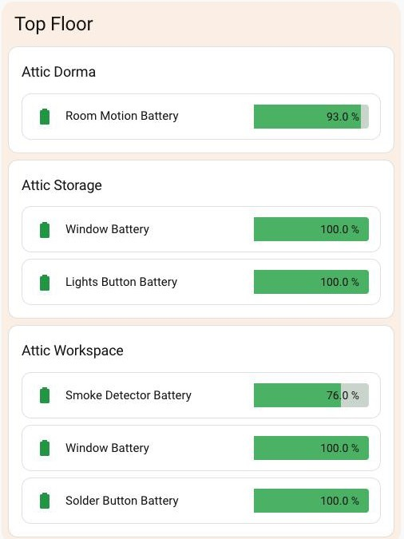
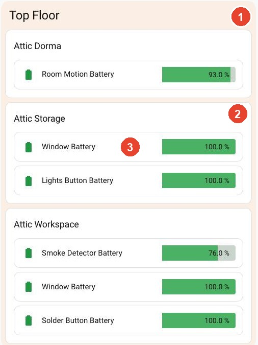

# Battery levels by floor and room

A Home Assistant dashboard recipe: every replaceable battery in the house as its own coloured progress bar, grouped by floor and then by room, filling itself in from the area registry.

There is no card to install for this. It is three existing cards composed together — the useful part is **how** they nest, and the handful of non-obvious fixes needed to make them behave.



---

## How this repo works

Every part has a number. That number is used on the parts table, in the folder name, and in the comment above the part in the all-in-one config file.

```
README.md                     ← you are here
battery-levels.yaml           ← the whole thing in one file, ready to paste
BUILD-WITH-AI.md              ← point your own AI at this repo
images/
parts/
  01-floor-section/           section.yaml      + README.md
  02-room-card/               room-card.yaml    + README.md
  03-battery-row/             battery-row.yaml  + README.md
shared/
  README.md                   ← the gotchas: card-mod ordering, contrast maths
```

**Pick your route:**

| I want to… | Go to |
|---|---|
| Have an AI build it for me | [BUILD-WITH-AI.md](BUILD-WITH-AI.md) |
| Build all of it myself | [Quick start](#quick-start) |
| Take just one part | [The parts](#the-parts) |
| Understand why it looks like that | [shared/README.md](shared/README.md) |

---

## The parts



| # | Part | What it does | Built from |
|---|---|---|---|
| 1 | [Floor section](parts/01-floor-section/README.md) | One tinted, full-width block per floor, with the floor's name | native `grid` section + Mushroom title |
| 2 | [Room card](parts/02-room-card/README.md) | One titled card per room, filled from the area registry, lowest battery first | `custom:auto-entities` + native `entities` |
| 3 | [Battery row](parts/03-battery-row/README.md) | One battery: coloured icon, name, and a bar with the percentage inside it | `custom:bar-card` + `card-mod` |

They nest, outermost first:

```
sections view
└── grid section                     Part 1 — "Top Floor"
    ├── mushroom-title-card          the floor name
    └── custom:auto-entities         Part 2 — one per room
        ├── card: entities           titled container ("Attic Dorma")
        └── filter.include[].options Part 3 — a whole bar-card config
```

The idea doing the work is in Part 2: **auto-entities' `options` accepts an entire card config**, not just an icon or a name override. auto-entities merges `entity: <id>` into it for every entity the filter matches, so each battery becomes its own bar-card. Combine that with an `area:` filter and the room card maintains itself — add a battery device to a room and its row appears.

[shared/README.md](shared/README.md) covers the things that cost the most time: why the icon colour needs `!important`, why the corners were square, and the contrast measurements behind the green.

---

## What you need

| Card | Why | Tested with |
|---|---|---|
| [auto-entities](https://github.com/thomasloven/lovelace-auto-entities) | Finds the batteries per area and sorts them | v1.16.1 |
| [Bar Card](https://github.com/vogon1/bar-card) | Draws the row | v5.0.1 |
| [card-mod](https://github.com/thomasloven/lovelace-card-mod) | Icon colour, corner radius, padding | v4.2.1 |
| [Mushroom](https://github.com/piitaya/lovelace-mushroom) | Floor titles only — swap for a native `heading` card to avoid it | v5.2.3 |

Tested on **Home Assistant 2026.10.2**.

> ⚠️ **Install `vogon1/bar-card`, not `custom-cards/bar-card`.** The original has had no commit since 2023 and has been **removed from HACS**, so it is no longer installable that way. `vogon1/bar-card` is the maintained fork and is a drop-in replacement.

Your batteries also need to report as `device_class: battery` with unit `%`, and their devices need to be **assigned to areas, and those areas assigned to floors**. That is what the whole layout is built on.

## Quick start

1. Install these four from HACS, then hard-refresh the browser (or **Settings → Reset frontend cache** in the Companion app). A card that hasn't been fetched yet shows as *"Custom element doesn't exist"* — that's the cache, not your config.

   - [auto-entities](https://github.com/thomasloven/lovelace-auto-entities) — search HACS for *auto-entities*
   - [Bar Card](https://github.com/vogon1/bar-card) — search HACS for *Bar Card*, and take the one by **vogon1** ([see the warning above](#what-you-need))
   - [card-mod](https://github.com/thomasloven/lovelace-card-mod) — search HACS for *card-mod*
   - [Mushroom](https://github.com/piitaya/lovelace-mushroom) — search HACS for *Mushroom* (optional, titles only)
2. Check your floors and areas exist: **Settings → Areas, labels & zones**.
3. Open the dashboard → **Edit** → three-dot menu → **Raw configuration editor**.
4. Paste [`battery-levels.yaml`](battery-levels.yaml) under `views:`.
5. Search the pasted text for `CHANGE` and work through every one — see below.
6. Repeat the floor section per floor, and the room card per room.

## Swap in your own rooms

| Find | Replace with |
|---|---|
| `title: Top Floor` | Your floor's name |
| `title: Attic Dorma` | The room name you want on the card |
| `area: Attic Dorma` | The same room, spelled **exactly** as in your area registry |
| the `exclude:` patterns | Substrings from your own rechargeable devices' entity IDs, or delete the block |

The `exclude:` list is what keeps phones, tablets, laptops and robot vacuums out. They report a battery percentage but you never replace a cell in them, so leaving them in makes a "low battery" count meaningless. Delete the block if you'd rather see everything.

## Licence

[MIT](LICENSE) — use, copy and change anything here, for any purpose.

The cards this recipe composes (auto-entities, Bar Card, card-mod, Mushroom) are separate projects and keep their own licences.

## Credits

- [auto-entities](https://github.com/thomasloven/lovelace-auto-entities) and [card-mod](https://github.com/thomasloven/lovelace-card-mod) by [Thomas Lovén](https://github.com/thomasloven)
- [Bar Card](https://github.com/vogon1/bar-card) by [vogon1](https://github.com/vogon1), a maintained fork of the original [custom-cards/bar-card](https://github.com/custom-cards/bar-card)
- [Mushroom](https://github.com/piitaya/lovelace-mushroom) by [Paul Bottein](https://github.com/piitaya)
