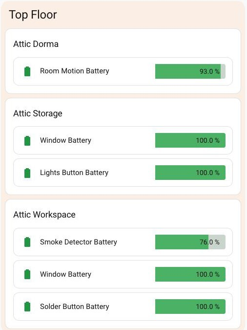

[All parts](../../README.md#the-parts) · [Part 2 →](../02-room-card/README.md)

# Part 1 · Floor section



One tinted, full-width block per floor, holding that floor's room cards. The image above is a single section: the floor name, then three room cards.

## At a glance

| | |
|---|---|
| **Built from** | native `grid` section + [Mushroom](https://github.com/piitaya/lovelace-mushroom) title card |
| **Files in this folder** | `section.yaml` (the section, with the floor title) · `card.jpg` |
| **Also needs** | A `sections` view with `max_columns: 3` |
| **Reads** | Nothing — it's layout only |

## Settings I chose

- **`column_span: 3`** — the section spans the view's full width. This is what lets the room cards inside flow three-across on a desktop and collapse to one on a phone.
- **`background: {color: accent, opacity: 10}`** — a faint tint so a floor reads as one block without needing a border around it.
- **Mushroom title card for the floor name**, with `--mush-title-padding: 4px 8px` to pull it tighter than the default.

## How the 3-across works

It's the only bit of grid arithmetic in the recipe, and it's worth knowing because it decides how many rooms sit side by side.

A section's grid is **12 columns × its `column_span`**. With `column_span: 3` that's **36 columns** on a wide screen. A card with no `grid_options` takes the default **12** — so three fit per row. When the layout collapses on a narrow screen the section is 12 columns again, and each room card takes the full width.

If you want **two** rooms across instead of three, give each room card `grid_options: {columns: 18}`.

## Don't want Mushroom?

The title card is the only thing in this recipe that needs it. Swap it for the native heading card:

```yaml
- type: heading
  heading: Top Floor
  heading_style: title
```

## Add just this part

1. Make sure your view is `type: sections` with `max_columns: 3`.
2. Paste `section.yaml` into the view's `sections:` list.
3. Change `title: Top Floor` to your floor's name.
4. Repeat once per floor. Order them however you think of the house — this recipe runs top-down (Top Floor, Upstairs, Downstairs, Outside).
5. Add room cards inside it — [Part 2](../02-room-card/README.md).

---

[All parts](../../README.md#the-parts) · [Part 2 →](../02-room-card/README.md)
