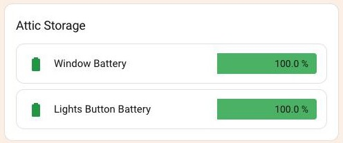

[← Part 1](../01-floor-section/README.md) · [All parts](../../README.md#the-parts) · [Part 3 →](../03-battery-row/README.md)

# Part 2 · Room card



One titled card per room — "Attic Storage" above. It finds that room's batteries itself from the area registry, sorts them lowest first, and renders each one as a [battery row](../03-battery-row/README.md).

## At a glance

| | |
|---|---|
| **Built from** | [auto-entities](https://github.com/thomasloven/lovelace-auto-entities) wrapping a native `entities` card |
| **Files in this folder** | `room-card.yaml` (one room, with the battery row inlined) · `card.jpg` |
| **Also needs** | [Bar Card](https://github.com/vogon1/bar-card), [card-mod](https://github.com/thomasloven/lovelace-card-mod) |
| **Reads** | Any `sensor` with `device_class: battery` and unit `%`, assigned to this area |

## How it works

```
custom:auto-entities
├── card:   entities card, title = the room      ← container only
├── filter: area + device_class + unit           ← which batteries
├── sort:   state, numeric                       ← lowest first
└── filter.include[0].options: custom:bar-card   ← how each row looks (Part 3)
```

The `entities` card is used **only** as a titled frame. Every row inside it is replaced by a bar-card, so none of the entities card's own row rendering survives.

## Settings I chose

- **`area: <room>`** rather than a list of entity IDs. This is the point of the whole thing: the card follows the area registry, so adding a battery device to that room makes a row appear with no config change.
- **`sort: {method: state, numeric: true}`** — `numeric: true` is not optional. Without it the states sort as strings and `100` lands before `29`.
- **`show_empty: false`** — a room with no batteries disappears instead of leaving a titled, empty box.
- **`attributes: {device_class: battery, unit_of_measurement: "%"}`** — the unit matters. It filters out battery sensors that report volts or an enum like `high`/`low`, which can't be drawn on a 0–100 bar.
- **`.card-header { font-size: 18px }`** — the entities card's default title is small for something acting as a room heading.

## What I changed

1. **Replaced the row rendering entirely.** `filter.include[].options` is set to a complete `custom:bar-card` config rather than an icon or name override. See [shared/README.md](../../shared/README.md#auto-entities-options-takes-a-whole-card).
2. **Added an exclude list** for devices that charge themselves — phones, tablets, laptops, robot vacuums, wearables. They report a battery percentage, but you never replace a cell in them, so counting them makes a "low battery" total meaningless.
3. **Kept the entities card as the container** instead of a bare grid, because its header gives the room its name and frame for free.

## Add just this part

1. Paste `room-card.yaml` into a floor section's `cards:` list ([Part 1](../01-floor-section/README.md)).
2. Change **both** `title:` and `area:` to your room. They're separate on purpose — the title is what's displayed, `area:` must match the area registry exactly.
3. Edit the `exclude:` patterns to match your own rechargeable devices, or delete the whole `exclude:` block to list everything.
4. Repeat once per room.

If a room card doesn't appear at all, it's almost always `show_empty: false` doing its job — the `area:` name doesn't match the registry, so nothing matched.

---

[← Part 1](../01-floor-section/README.md) · [All parts](../../README.md#the-parts) · [Part 3 →](../03-battery-row/README.md)
