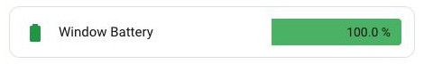

[← Part 2](../02-room-card/README.md) · [All parts](../../README.md#the-parts)

# Part 3 · Battery row



One battery: a severity-coloured icon, the device name, and a bar with the percentage sitting inside it. Each row keeps its own card outline inside the room card — that's deliberate, not a bug.

## At a glance

| | |
|---|---|
| **Built from** | [Bar Card](https://github.com/vogon1/bar-card) (`vogon1` fork) + [card-mod](https://github.com/thomasloven/lovelace-card-mod) |
| **Files in this folder** | `battery-row.yaml` (annotated; it is the `options:` block from Part 2) · `card.jpg` |
| **Also needs** | Nothing on its own — it's generated by [Part 2](../02-room-card/README.md) |
| **Reads** | One `sensor` with `device_class: battery`, unit `%` |

> This file is **not** a card you paste on its own. It's the value of `options:` inside the room card's filter. It's split out here so it can be explained without the surrounding config in the way.

## The layout

```
[icon]  Window Battery          [▓▓▓▓▓▓▓▓▓░  100.0 %]
└─16px  └─14px gap              └─ 38% of the row width ─┘
```

- `positions: {icon: outside, name: outside, value: inside}` gives exactly this: icon and name to the left of the bar, percentage inside it.
- `width: 38%` fixes the bar's share of the row, so the name takes the other 62%. Without it the bar takes whatever is left after the name, and rows with long and short device names get different bar lengths — which makes them impossible to compare down a column.

## Settings I chose

- **`height: 30px`** with `13px` padding above and below — a 56px row that stays readable at six rows per card.
- **`decimal: 1`.** It exists for the near-flat case: a battery at `0.5 %` is the most urgent row on the page and rounding it to `1 %` understates it. The cost is `100.0 %` everywhere else. It's one setting for the whole card, so it's one or the other.
- **`entity_row: true`** so bar-card renders as a row. It clears its own background and shadow but **not** its border — which is what gives each battery its outline inside the room card.
- **`min: 0` / `max: 100`** stated explicitly, so a sensor reporting something odd (one here reports `120`) can't rescale the bar.

## What I changed

Four `card_mod` fixes. All four are explained in full, with the reasoning, in [shared/README.md](../../shared/README.md) — summarised here:

1. **Icon colour** — bar-card hard-codes `bar-card-iconbar { color: var(--ha-icon-color) }`, and `severity.icon` only changes the icon's *shape*. Needs `!important`, because bar-card injects its stylesheet after card-mod's and wins on source order.
2. **Corner radius** — bar-card falls back to `--ha-card-border-radius`, which many themes never set, so it computes to `0`. Set to `0 4px 4px 0`: **square on the left on purpose**, because rounding that edge clips the fill on a nearly-flat battery.
3. **Row padding** — `entity_row: true` zeroes it. At `0` the bar fills the full row height and the icon jams against the card edge. `13px 14px 13px 16px` restores the proportions.
4. **Fill colour** — the green is `#66bb6a`, not `var(--success-color)`. The latter gives the percentage only 5.58:1 contrast; this gives 7.79:1. [The measurements](../../shared/README.md#contrast-why-the-green-is-not---success-color).

## Known rough edges

- **At 76–95% the `%` sign straddles the fill edge**, half on colour and half on the pale track. It's a consequence of right-aligning the value inside a track whose fill grows underneath it. Moving the value outside the bar avoids it, at the cost of the look.
- **`100.0 %`** is noisy — see `decimal` above.

## Add just this part

You don't add it on its own. Change it in place inside [Part 2](../02-room-card/README.md), where it's inlined as `options:`.

To restyle every battery at once, edit that one block — every room card carries an identical copy, so change them together or they'll drift.

---

[← Part 2](../02-room-card/README.md) · [All parts](../../README.md#the-parts)
